# Laboratorio: Análisis SCA local y en pipeline con Dependency-Check

**Curso:** PDDS — Trimestre 4 · **Universidad Galileo**

**Estudiante:** ______________________ · **Carné:** ____________

**Fecha:** 28 de octubre de 2026

## Entregables

| Entregable | Enlace |
| ---------- | ------ |
| Repositorio público | https://github.com/ChristianSosa22/javavulnerablelab-sca |
| Workflow | [`.github/workflows/sca-dependency-check.yml`](https://github.com/ChristianSosa22/javavulnerablelab-sca/blob/main/.github/workflows/sca-dependency-check.yml) |
| Pull Request de la remediación (Parte F del enunciado de entregables) | https://github.com/ChristianSosa22/javavulnerablelab-sca/pull/7 |
| Pull Request de las preguntas de análisis | https://github.com/ChristianSosa22/javavulnerablelab-sca/pull/8 |
| Reporte HTML de Dependency-Check (local) | [`entregables/dependency-check-report.html`](../entregables/dependency-check-report.html) |
| SBOM CycloneDX | [`entregables/bom.json`](../entregables/bom.json) |

El trabajo se organizó en un Pull Request por parte:

| PR | Contenido |
| -- | --------- |
| [#1](https://github.com/ChristianSosa22/javavulnerablelab-sca/pull/1) | Parte A: `.gitignore` (`target/`, reportes locales, `.env`) |
| [#2](https://github.com/ChristianSosa22/javavulnerablelab-sca/pull/2) | Entorno de desarrollo con Docker |
| [#3](https://github.com/ChristianSosa22/javavulnerablelab-sca/pull/3) | Parte B: Dependency-Check local y tabla de vulnerabilidades |
| [#4](https://github.com/ChristianSosa22/javavulnerablelab-sca/pull/4) | Parte C: SBOM y Dependency-Track |
| [#5](https://github.com/ChristianSosa22/javavulnerablelab-sca/pull/5) | Parte D: DefectDojo y comparación |
| [#6](https://github.com/ChristianSosa22/javavulnerablelab-sca/pull/6) | Parte E: pipeline de GitHub Actions |
| [#7](https://github.com/ChristianSosa22/javavulnerablelab-sca/pull/7) | Remediación de Log4Shell (log4j 2.12.1 → 2.12.4) |
| [#8](https://github.com/ChristianSosa22/javavulnerablelab-sca/pull/8) | Preguntas de análisis y este reporte |

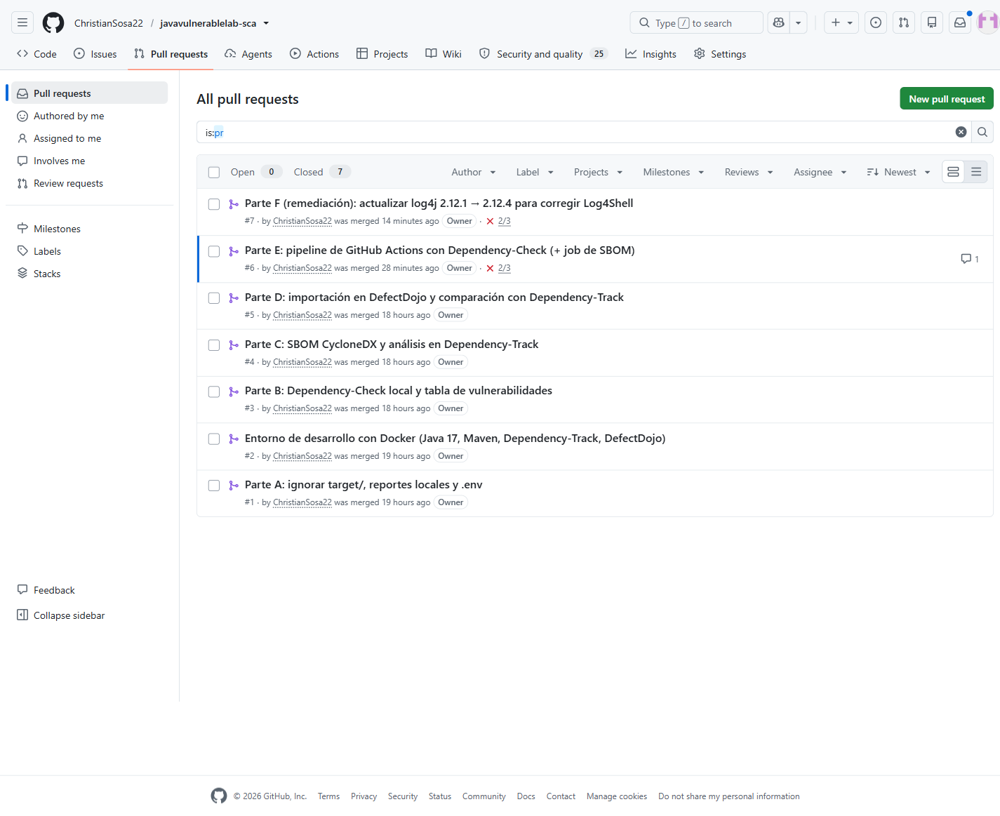

## Entorno de trabajo

Todo el laboratorio corrió en Docker Desktop, sin instalar Java ni Maven en la
máquina. [`docker-compose.sca.yml`](../docker-compose.sca.yml) define:

- `maven:3.9-eclipse-temurin-17` (Java 17.0.20 + Maven 3.9.16) para
  Dependency-Check y CycloneDX, con un volumen persistente para `~/.m2`, donde
  queda la base del NVD.
- Dependency-Track 4.14.6 (`http://localhost:8080`).
- DefectDojo 3.4.300 (`http://localhost:8082`).

La clave del NVD se lee de un archivo `.env` ignorado por git. Detalle en
[`docs/ENTORNO.md`](ENTORNO.md).

---

## Parte A — Repositorio propio

1. Se clonó `CSPF-Founder/JavaVulnerableLab` y se eliminó su carpeta `.git`.
2. Se creó el repositorio público `javavulnerablelab-sca` con el código
   original en el primer commit.
3. Se agregaron al `.gitignore` `target/`, las carpetas de reportes locales y
   `.env` (PR #1).

> GitHub *push protection* bloqueó el primer push porque el laboratorio trae
> dos claves de Stripe **falsas** a propósito (reto de secretos expuestos). Se
> marcaron como "used in tests" para conservar el código original.

Dependencias declaradas en el `pom.xml`:

| Dependencia | Versión | Alcance |
| ----------- | ------- | ------- |
| junit:junit | 3.8.1 | test |
| mysql:mysql-connector-java | 5.1.26 | compile |
| org.json:json | 20090211 | compile |
| javax.servlet:jstl | 1.2 | compile |
| org.hibernate:hibernate-core | 4.0.1.Final | compile |
| javax.servlet:servlet-api | 2.3 | provided |
| org.apache.logging.log4j:log4j-api | 2.12.1 | compile |
| org.apache.logging.log4j:log4j-core | 2.12.1 | compile |
| commons-collections:commons-collections | 3.1 | compile |
| commons-fileupload:commons-fileupload | 1.3.3 | compile |
| commons-io:commons-io | 2.6 | compile |

## Parte B — Dependency-Check en local

```powershell
docker compose -f docker-compose.sca.yml run --rm dependency-check
# mvn -B org.owasp:dependency-check-maven:13.0.0:check -Dformat=ALL
#     -DnvdApiKeyEnvironmentVariable=NVD_API_KEY -DossindexAnalyzerEnabled=false
```

La primera carga del NVD por la API tuvo errores y reintentos constantes
(12 % en 35 minutos), así que la base se cargó una vez con los *data feeds*
JSON 2.0 oficiales del NVD. Las ejecuciones siguientes usan la API con la clave
y solo descargan cambios (49 s con 2 112 registros nuevos).

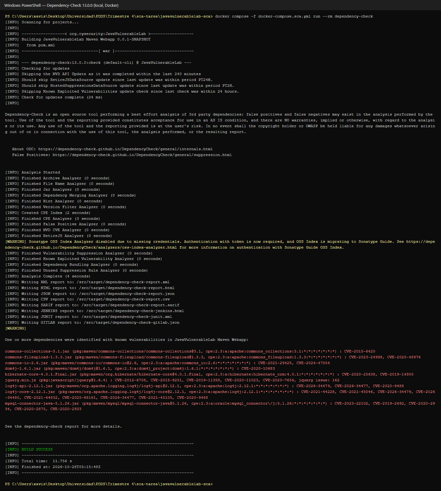

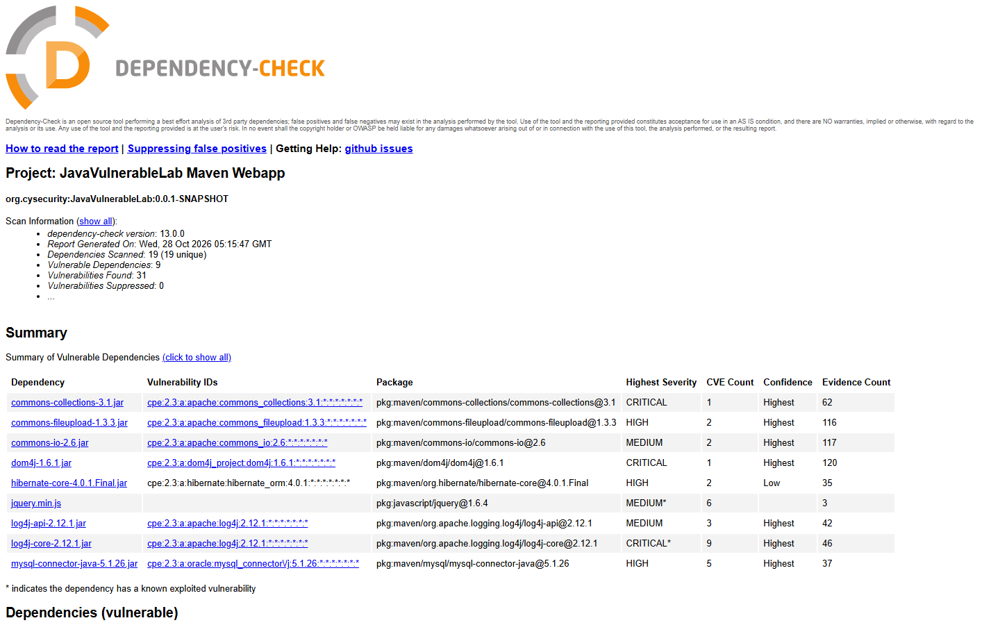

**Resultado:** 19 dependencias analizadas, **9 vulnerables, 31
vulnerabilidades** (4 Critical, 7 High, 16 Medium, 4 Low).

| Dependencia | Vulnerabilidades | Más grave |
| ----------- | ---------------- | --------- |
| log4j-core 2.12.1 | 9 | **CVE-2021-44228 Log4Shell (10.0)**, CVE-2021-45046 (9.0) |
| commons-collections 3.1 | 1 | CVE-2015-6420 (9.8) |
| dom4j 1.6.1 *(transitiva)* | 1 | CVE-2020-10683 (9.8) |
| mysql-connector-java 5.1.26 | 5 | CVE-2023-22102 (8.3) |
| commons-fileupload 1.3.3 | 2 | CVE-2023-24998, CVE-2025-48976 (7.5) |
| hibernate-core 4.0.1.Final | 2 | CVE-2020-25638 (7.4) |
| log4j-api 2.12.1 | 3 | CVE-2026-34479 (7.5) |
| jquery.min.js 1.6.4 | 6 | CVE-2012-6708 y otras (6.1) |
| commons-io 2.6 | 2 | CVE-2021-29425 (4.8) |

La tabla completa con los 31 CVE está en
[`docs/parte-b-dependency-check.md`](parte-b-dependency-check.md).

## Parte C — SBOM y Dependency-Track

- SBOM con `cyclonedx-maven-plugin:2.9.3:makeAggregateBom` (CycloneDX 1.6
  JSON): **18 componentes**, 10 directos y 8 transitivos de `hibernate-core`
  (`junit` se excluye por ser de `test`).
- Proyecto **JavaVulnerableLab 1.0** en Dependency-Track con la fuente **OSV
  (Maven)** activada: **29 vulnerabilidades** (4 Critical, 12 High, 11
  Medium, 2 Low).

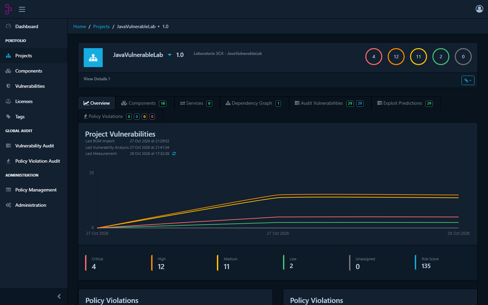

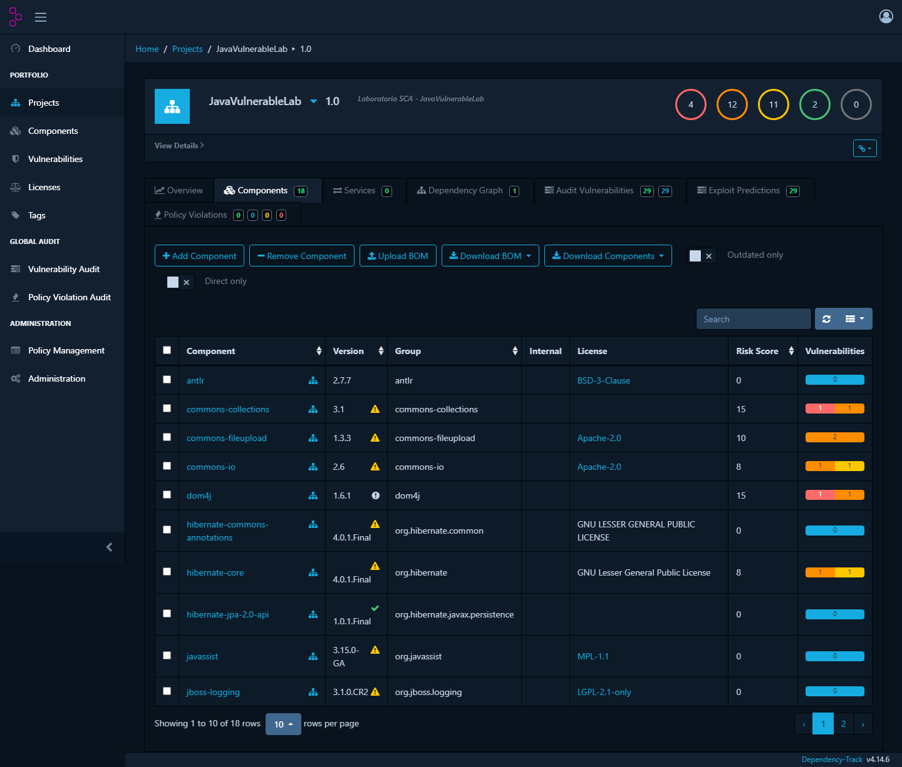

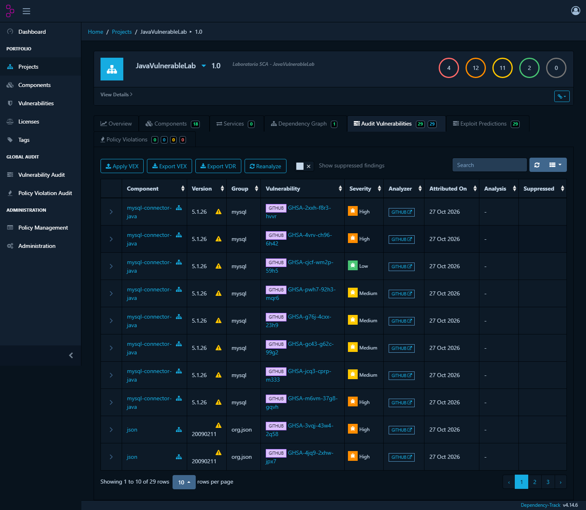

### Dependency Graph: origen de una transitiva vulnerable

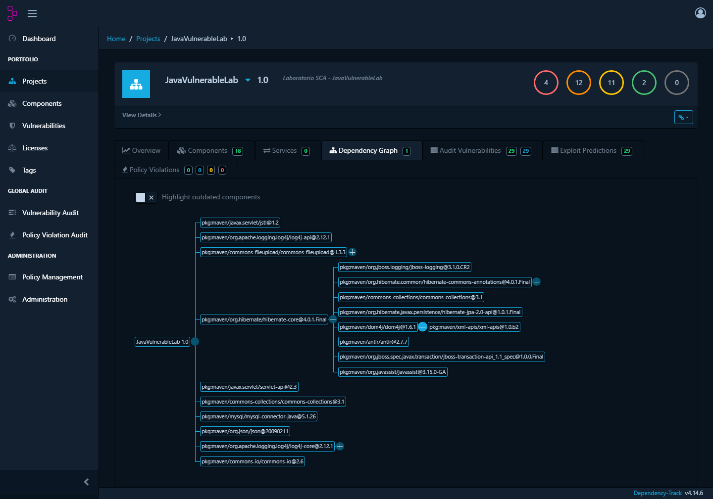

`dom4j 1.6.1` **no está declarada** en el `pom.xml`: llega porque
`hibernate-core 4.0.1.Final` la necesita
(`JavaVulnerableLab → hibernate-core → dom4j → xml-apis`). Tiene
**CVE-2020-10683** (XXE, 9.8) y **CVE-2018-1000632** (inyección XML). El
grafo también muestra que `commons-collections 3.1` llega tanto directa como
transitivamente (Hibernate), así que quitarla del `pom.xml` no la eliminaría
del WAR.

## Parte D — DefectDojo y comparación

Producto **JavaVulnerableLab**, importación de `dependency-check-report.xml`
con el tipo **Dependency Check Scan**: **31 hallazgos** (4 Critical, 7 High,
16 Medium, 4 Low).

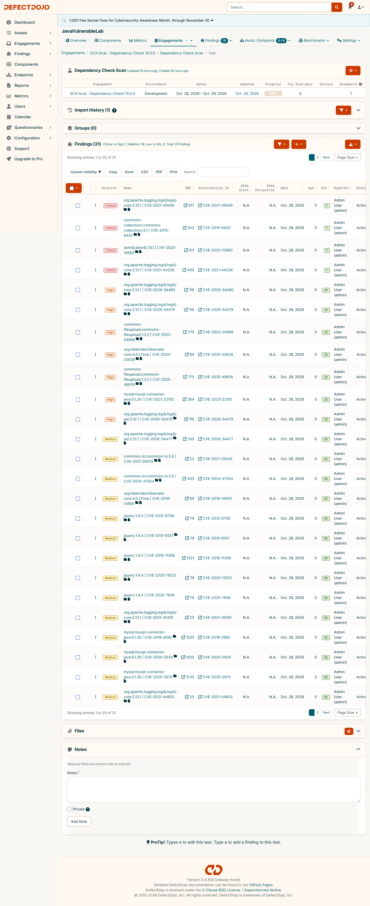

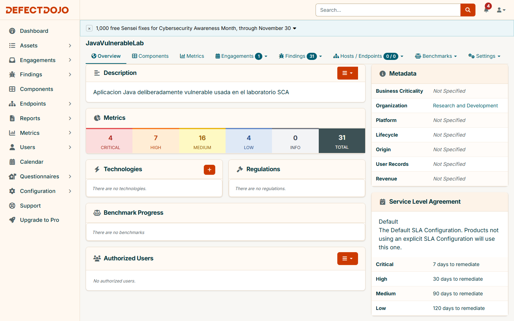

### Comparación

| | Dependency-Check / DefectDojo | Dependency-Track |
| --- | --- | --- |
| Identificación | CPE inferido por evidencia | PURL exacto del SBOM |
| Fuentes | NVD, CISA KEV, RetireJS | NVD + OSV (GitHub Advisories) |
| Componentes vulnerables | 9 | 8 |
| Hallazgos | 31 | 29 |
| Pares componente+CVE en común | 19 | 19 |
| Solo en esta herramienta | 12 | 10 |

**¿Coinciden?** En lo importante sí: 7 componentes son vulnerables en ambas,
y las dos detectan Log4Shell, las críticas de `dom4j` y de
`commons-collections`, y los mismos 9 CVE de `log4j-core`.

**¿Una encontró lo que la otra no?** Sí:

- **Solo Dependency-Check:** `jquery.min.js` (6, archivo JS que no está en el
  SBOM de Maven), `log4j-api` (3, comparte el CPE `apache:log4j` con core:
  probables falsos positivos) y 3 CVE de `mysql-connector-java`.
- **Solo Dependency-Track:** `org.json 20090211` (2, el CPE del NVD no coincide
  con el JAR: falso negativo de Dependency-Check), CVE-2015-7501 (crítica) en
  `commons-collections`, CVE-2018-1000632 en `dom4j` y 6 CVE de MySQL que
  vienen de avisos GHSA.

**¿Por qué?** Por identificación distinta (CPE vs PURL), fuentes distintas
(NVD vs OSV/GHSA), alcance distinto (archivos del proyecto vs dependencias del
SBOM) y momentos de actualización distintos. Detalle en
[`docs/parte-d-defectdojo.md`](parte-d-defectdojo.md).

## Parte E — Pipeline con Dependency-Check

Archivo [`.github/workflows/sca-dependency-check.yml`](../.github/workflows/sca-dependency-check.yml)
(todas las líneas comentadas).

| # | Requisito | Implementación |
| - | --------- | -------------- |
| 1 | Disparadores | `push` y `pull_request` a `main`, `workflow_dispatch` |
| 2 | Permisos mínimos | `contents: read`, `security-events: write` |
| 3 | Java 17 | `actions/setup-java@v6` (Temurin 17) |
| 4 | Secreto | `NVD_API_KEY` → `${{ secrets.NVD_API_KEY }}` como variable de entorno, leída con `-DnvdApiKeyEnvironmentVariable` |
| 5 | Caché del NVD | `actions/cache/restore` + `actions/cache/save` con `if: always()` sobre `~/.m2/repository/org/owasp/dependency-check-data` y clave diaria |
| 6 | Formatos | `-Dformats=HTML,XML,JSON,SARIF` |
| 7 | Code scanning | `github/codeql-action/upload-sarif@v4`, `category: dependency-check` |
| 8 | Artefactos | `dependency-check-reports` (HTML, XML, JSON, SARIF) |
| 9 | Comentarios | Cada línea del YAML lleva comentario |
| Extra | SBOM | Job `sbom` → artefacto `sbom-cyclonedx` |

Decisiones:

- **Puerta de seguridad** `failBuildOnCVSS=7`: el job falla si hay
  vulnerabilidades High o Critical. Los pasos de publicación usan
  `if: always()`, así el SARIF y los reportes se suben igual. En este proyecto,
  vulnerable a propósito, el job queda en rojo incluso después de la
  remediación.
- **Caché separada en restore/save** porque `actions/cache` solo guarda si el
  job termina bien, y aquí el análisis falla a propósito. La primera ejecución
  tardó 54 min en construir la base; las siguientes, unos 2 min.
- **Carga inicial sin caché** desde los *data feeds* oficiales del NVD (solo
  si no se restauró ninguna caché); después las actualizaciones van por la API
  con la clave.

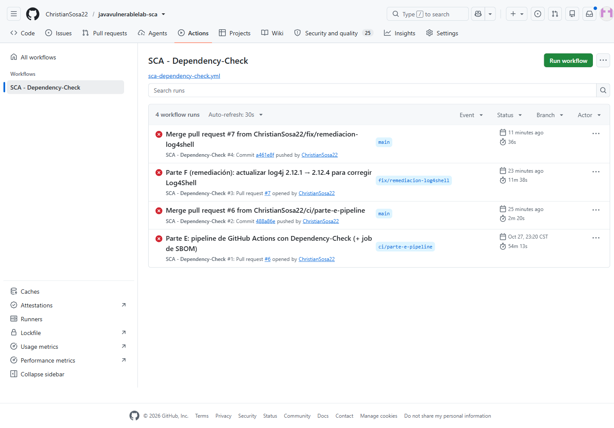

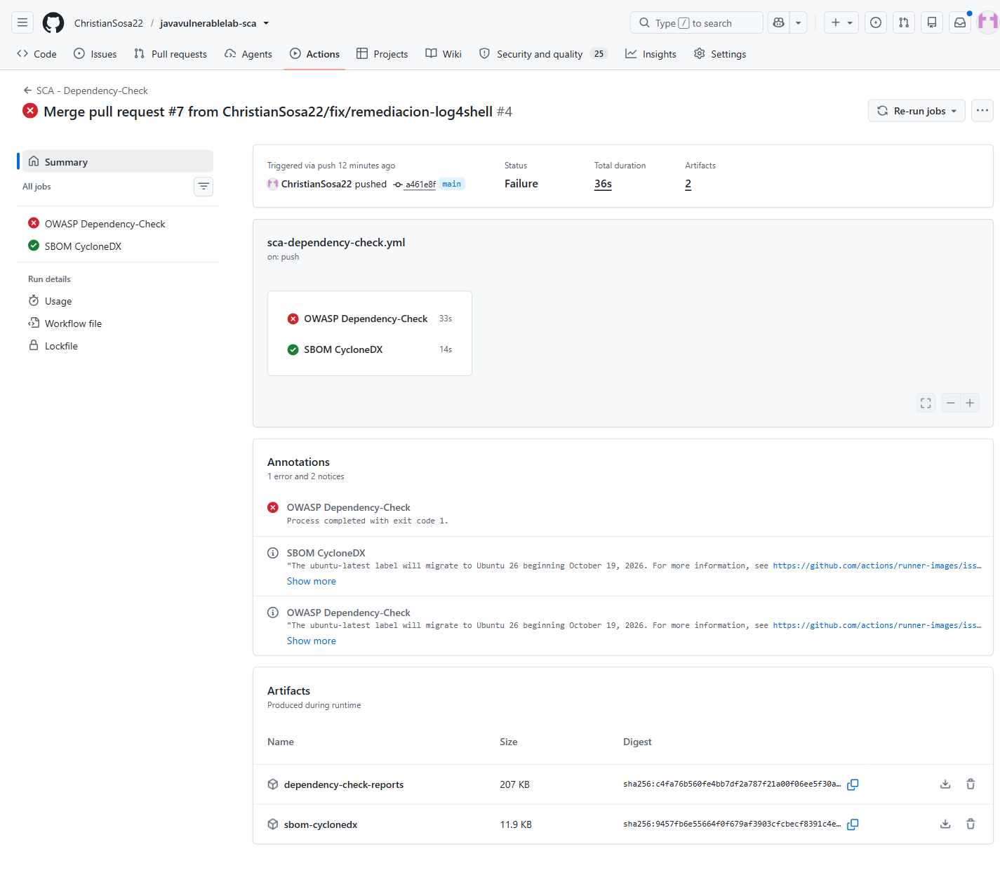

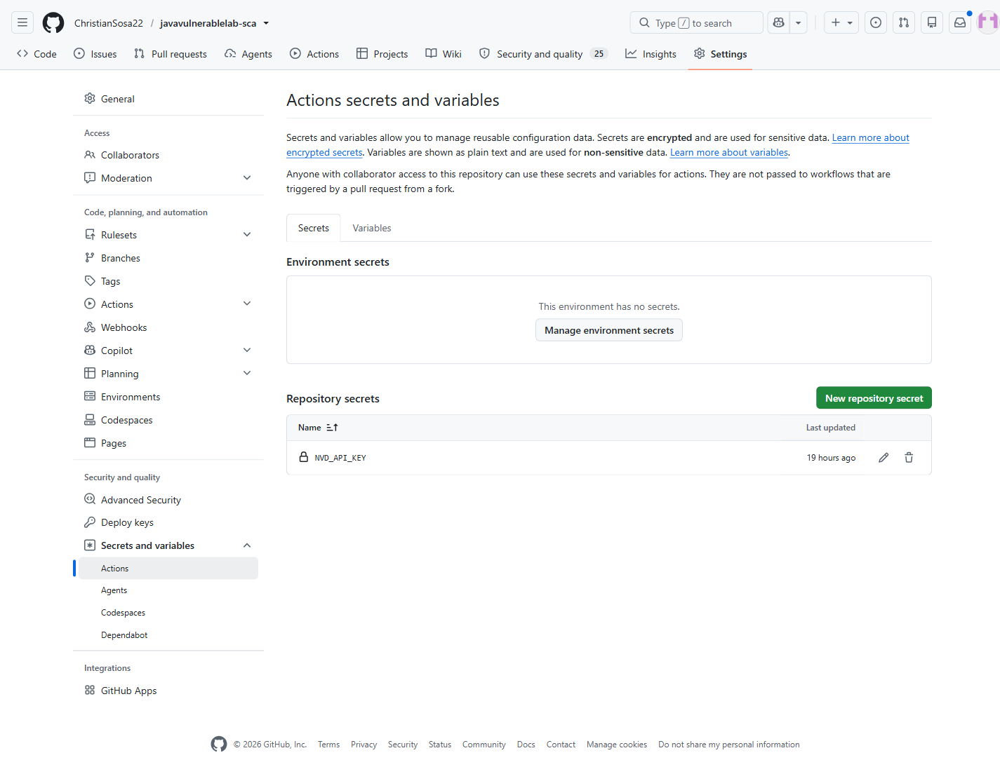

Explicación completa en [`docs/parte-e-pipeline.md`](parte-e-pipeline.md).

## Remediación (PR #7)

`log4j-api` y `log4j-core` **2.12.1 → 2.12.4**. La aplicación corre en Java 7
/ Tomcat 7, y 2.12.4 es la última versión de log4j para Java 7 (desde 2.13 se
exige Java 8). Corrige **CVE-2021-44228 (Log4Shell)**, CVE-2021-45046,
CVE-2021-45105, CVE-2021-44832 y CVE-2020-9488.

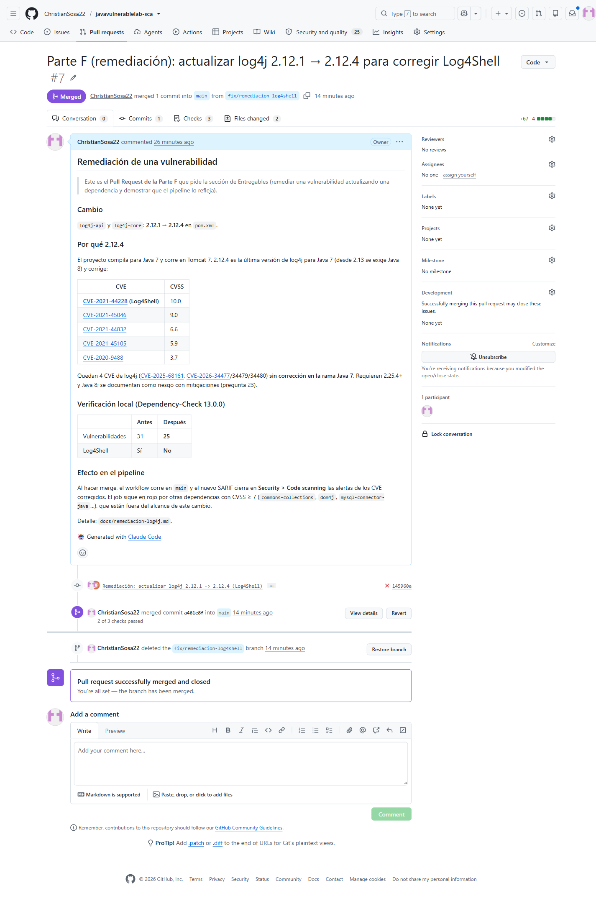

### Code scanning antes y después

**Antes:** 31 alertas abiertas, con Log4Shell y CVE-2021-45046 como *Critical*.

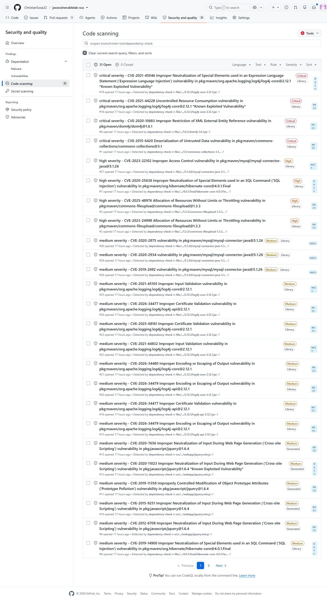

**Después:** 25 alertas abiertas y 12 cerradas como *Fixed*, entre ellas
**CVE-2021-44228** y CVE-2021-45046.

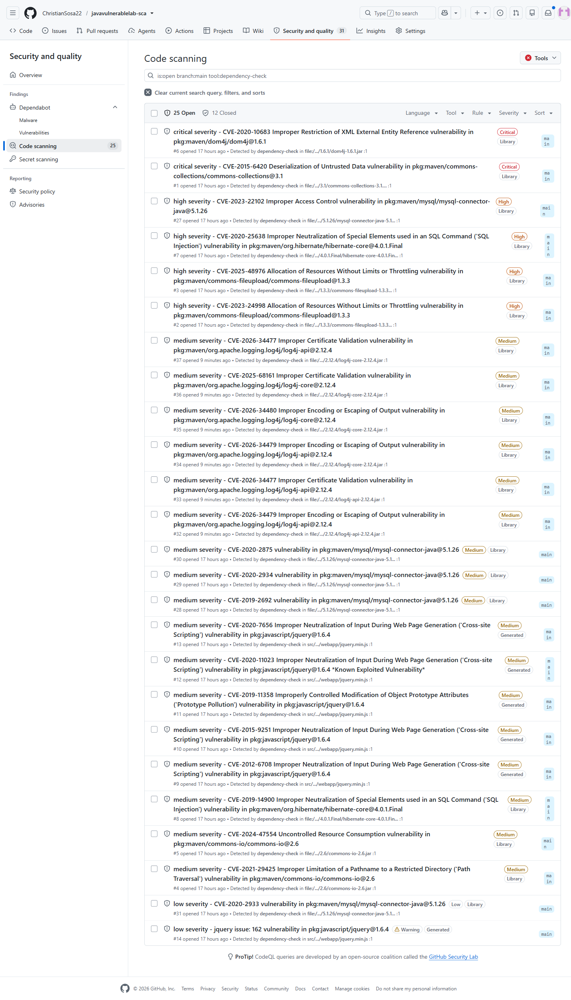

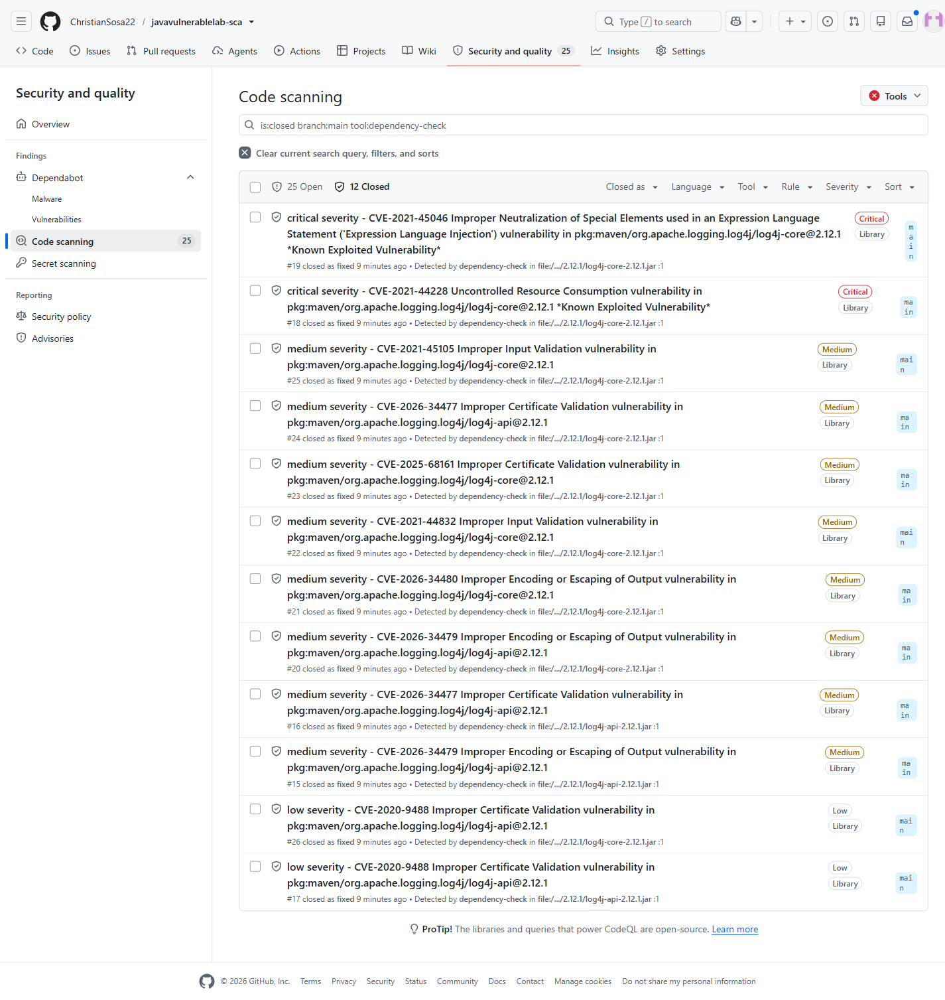

GitHub identifica cada alerta por regla (CVE) **y ubicación** (el JAR). Al
cambiar `log4j-core-2.12.1.jar` por `log4j-core-2.12.4.jar`, se cierran las 12
alertas del JAR viejo y se abren 6 nuevas en el JAR nuevo para los 4 CVE que
**no tienen corrección en la rama Java 7** (CVE-2025-68161, CVE-2026-34477,
CVE-2026-34479, CVE-2026-34480): 31 − 12 + 6 = 25. Esos CVE requieren log4j
2.25.4+ (Java 8) y se gestionan como riesgo aceptado con mitigaciones (ver
pregunta 23).

---

## Preguntas de análisis

### 19. ¿Qué diferencia hay entre SAST y SCA? ¿Por qué una aplicación necesita ambos?

**SAST** analiza el **código propio**: busca patrones inseguros como inyección
SQL, XSS o deserialización sin validar, y señala la línea exacta del problema
(por ejemplo, Semgrep). **SCA** analiza el **código de terceros**: identifica
cada librería directa y transitiva (nombre, versión, CPE o PURL) y la cruza con
bases de vulnerabilidades conocidas (NVD, OSV, GitHub Advisories). También
sirve para revisar licencias.

Se necesitan ambos porque cubren superficies distintas. En JavaVulnerableLab,
SAST encuentra la inyección SQL de las páginas JSP, pero no puede saber que
`log4j-core 2.12.1` es vulnerable a Log4Shell, porque ese código no está en el
repositorio. SCA encuentra Log4Shell, pero no ve la inyección SQL escrita a
mano. La mayor parte del código que se ejecuta en una aplicación moderna viene
de dependencias, y a la vez una aplicación con todas sus dependencias al día
puede seguir siendo vulnerable por su propio código.

### 20. ¿Qué es una dependencia transitiva y por qué es difícil de controlar? Ejemplo del proyecto

Es una librería que el proyecto **no declara**, pero que llega porque una
dependencia directa la necesita; Maven la resuelve y la empaqueta en el WAR.
Es difícil de controlar porque no aparece en el `pom.xml` (hay que usar
`mvn dependency:tree` o un SBOM para verla), su versión la decide el autor de
la dependencia directa, el árbol puede ser profundo y la misma librería puede
llegar por varios caminos, y actualizarla obliga a subir la directa (puede
romper la API) o a forzar la versión con `<dependencyManagement>` (puede romper
la directa).

**Ejemplo:** el `pom.xml` solo declara `hibernate-core 4.0.1.Final`, que trae
`dom4j 1.6.1` con **CVE-2020-10683** (XXE, 9.8) y CVE-2018-1000632. El
Dependency Graph muestra `JavaVulnerableLab → hibernate-core → dom4j`.
Corregirlo exige subir Hibernate a una versión que use `org.dom4j:dom4j 2.1.3+`
o forzar esa versión y probar que Hibernate 4.0 siga funcionando.

### 21. ¿Qué ventaja tiene Dependency-Track (monitoreo continuo del SBOM) frente a ejecutar Dependency-Check solo en el pipeline?

El pipeline es una **foto puntual**: solo analiza cuando hay push o PR. Si se
publica un CVE nuevo y el repositorio no recibe cambios en un mes, nadie se
entera durante ese mes. Dependency-Track guarda el SBOM de cada versión
desplegada y lo **reevalúa continuamente** cada vez que actualiza sus fuentes,
sin recompilar. Además ofrece alertas automáticas (correo, Slack, webhooks),
un inventario de toda la organización ("¿qué proyectos usan log4j 2.12.1?",
clave durante Log4Shell), auditoría con supresiones justificadas, métricas
históricas, políticas de licencias y seguridad, y EPSS para priorizar. Lo ideal
es combinar ambos: Dependency-Check como **puerta** en el pipeline y
Dependency-Track como **monitoreo** de lo desplegado.

### 22. ¿Por qué Dependency-Check y Dependency-Track pueden reportar resultados distintos para el mismo proyecto?

1. **Identificación:** Dependency-Check infiere el CPE a partir de la evidencia
   del JAR (nombre, manifiesto, `pom.properties`), lo que produce falsos
   positivos (`log4j-api` con CVE de core) y falsos negativos (`org.json`).
   Dependency-Track usa el PURL exacto del SBOM.
2. **Fuentes:** NVD (+ KEV, RetireJS) frente a NVD + OSV/GitHub Advisories,
   cada una con su cobertura y sus rangos de versiones (CVE-2015-7501 solo
   aparece por GHSA).
3. **Alcance:** Dependency-Check analiza también archivos como
   `jquery.min.js`; el SBOM de Maven solo describe dependencias Maven.
4. **Momento de actualización** de cada base local.
5. **Configuración:** analizadores desactivados (OSS Index), supresiones y
   deduplicación de alias (CVE ↔ GHSA).

### 23. Si una librería vulnerable no tiene versión corregida, ¿qué alternativas hay para gestionar el riesgo?

1. **Analizar si el código vulnerable es alcanzable** y, si no lo es,
   documentarlo y suprimir el hallazgo con justificación (supresión de
   Dependency-Check, estado *Not Affected* o VEX en Dependency-Track).
2. **Reemplazar** la librería por una alternativa mantenida, o **excluirla**
   (`<exclusions>`) si es transitiva y no se usa.
3. **Mitigar por configuración:** en log4j, no usar `XmlLayout`,
   `Log4j1XmlLayout` ni el Socket Appender con TLS (los 4 CVE que quedaron sin
   corrección en 2.12.4), o en su momento `-Dlog4j2.formatMsgNoLookups=true`
   para Log4Shell.
4. **Parchear o hacer *fork*** y publicar una versión interna corregida.
5. **Controles compensatorios:** WAF o RASP, validación de entrada,
   segmentación de red, mínimo privilegio y monitoreo de explotación.
6. **Aceptar el riesgo formalmente** con responsable, fecha de revisión y
   severidad real (CVSS + EPSS + exposición), y planificar la migración (aquí:
   pasar a Java 8 y log4j 2.25.4+). Dependency-Track avisa automáticamente
   cuando sale una versión corregida.
